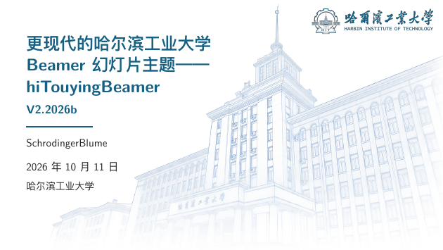
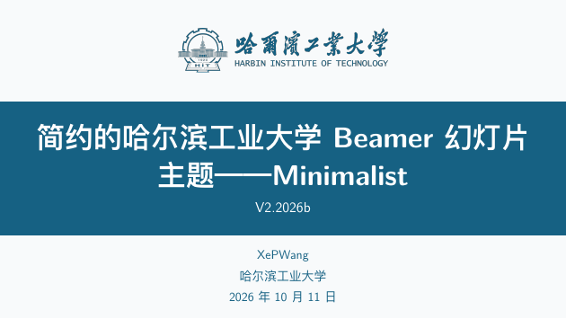
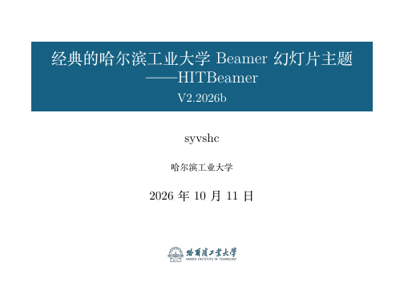
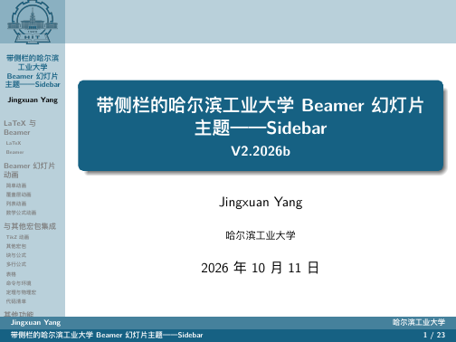

# 更现代的哈尔滨工业大学 Beamer 幻灯片主题 hiTouyingBeamer（读作「嗨！投影 Beamer」）


本主题的灵感来自于上海交通大学 Touying 幻灯片主题
（[touying-simpl-sjtu](https://github.com/sjtug/touying-sjtu)）。

## 预览

| 现代（默认） | 简约（`minimalist`） | 经典（`classic`） | 侧栏（`sidebar`） |
| :---: | :---: | :---: | :---: |
| [](template.pdf) | [](template-minimalist.pdf) | [](template-classic.pdf) | [](template-sidebar.pdf) |

## 主题

| 主题 | 选项 | 画幅 | 作者 | 说明 |
| --- | --- | --- | --- | --- |
| 现代 | 不写 / `touying` | 16:9 | [SchrodingerBlume](https://github.com/SchrodingerBlume) | 默认主题，Touying 风格 |
| 简约 | `minimalist` | 16:9 | [XePWang](https://github.com/XePWang) | 顶部章节导航、浅灰画布 |
| 经典 | `classic` | 4:3 | [syvshc](https://github.com/syvshc) | 移植自旧 [HITBeamer](https://github.com/hithesis/HITBeamer) |
| 侧栏 | `sidebar` | 4:3 | [Jingxuan Yang](https://github.com/YangLaTeX) | 左侧栏导航与两行页脚，移植自 [hitszbeamer](https://github.com/YangLaTeX/hitszbeamer) |

## 快速开始

```latex
\documentclass[aspectratio=169]{ctexbeamer}
\usetheme{hit}

\title{标题}
\subtitle{副标题}
\author{作者}
\institute{哈尔滨工业大学}
\date{\today}

\begin{document}
\TitleSlide      % 白色封面（\BlueTitleSlide 为照片封面）
\OutlineSlide    % 目录页

\section{第一节}
\begin{frame}{帧标题}
  正文
\end{frame}

\EndSlide{感谢使用\par\medskip Thanks for Using!}
\end{document}
```

用 XeLaTeX 编译，参考文献（biber）由 latexmk 自动处理：

```console
latexmk -xelatex template.tex
```

`template.tex` 是模板兼完整示例，从这里开始写；章节过渡页与导航条需要编译两遍才稳定。

## 主题选项

| 选项 | 说明 |
| --- | --- |
| `touying` / `classic` / `minimalist` / `sidebar` | 选择主题；不写为现代主题 |
| `minted` | 代码用 minted 排版（编译加 `-shell-escape`） |
| `serif` / `sans` | 衬线 / 非衬线字体；经典默认衬线，现代与简约默认非衬线 |
| `top` / `center` | 正文顶部对齐 / 垂直居中（默认） |
| `navsymbols` / `nonavsymbols` | 右下角翻页按钮：显示 / 隐藏（默认） |
| `sectionpage` / `nosectionpage` | 章节页开关：现代、经典默认插，简约、侧栏默认不插，显式写了以写的为准 |

## 专用命令

| 命令 | 说明 |
| --- | --- |
| `\TitleSlide` / `\BlueTitleSlide` | 白色 / 照片封面 |
| `\OutlineSlide` | 目录页（标题可 `\renewcommand{\hitoutlinetitle}{...}`） |
| `\FocusSlide{...}` | 整页强调页 |
| `\EndSlide{...}` | 结束页 |
| `\hitfooter{...}` | 页脚左侧文字（默认继承 `\institute`） |
| `\themetitle` / `\themeauthor` / `\themecredit` | 当前主题预置的标题 / 作者 / 来源说明 |
| `\renewcommand{\hitvipath}{...}` | `vi/` 视觉形象资产目录路径 |

封面、目录等前置页用罗马数字计数，正文从 1 起算（现代主题）；简约显示物理页码，
经典按 beamer 原样。

## 文件结构

| 文件 | 说明 |
| --- | --- |
| `beamerthemehit.sty` | 主题入口（`\usetheme{hit}`）：解析选项，分派到主题文件 |
| `beamerthemehitouying.sty` | 现代主题 |
| `beamerthemehitclassic.sty` | 经典主题 |
| `beamerthemehitminimalist.sty` | 简约主题 |
| `beamerthemehitsidebar.sty` | 侧栏主题 |
| `beamercmdhit.sty` | 文档命令与配套包（`\upcite`、`\cmd`、`\env`、unicode-math、physics、listings 等），各主题共用，主题会自动加载 |
| `template.tex` | 模板兼完整示例，从这里开始写 |
| `vi/` | 哈尔滨工业大学视觉形象素材（获取自网络，经 AI 处理，如有侵权请联系 hiThesis 团队） |

## 安装到 TEXMFHOME（可选）

把 `.sty` 和 `vi/` 放进 `TEXMFHOME`（如 `~/texmf/tex/latex/hitouyingbeamer/`），
再在文档里 `\renewcommand{\hitvipath}{<vi 的绝对路径>/}`。

## 从旧 HITBeamer 迁移

见旧仓库 [hithesis/HITBeamer](https://github.com/hithesis/HITBeamer) 的 README。

## License

本作品采用 LaTeX Project Public License 1.3c（LPPL-1.3c）发布，[LICENSE](LICENSE)
是 LPPL 全文；维护状态为 `maintained`，当前维护者
[@SchrodingerBlume](https://github.com/SchrodingerBlume)。

版权与来源：现代主题派生自 touying-simpl-sjtu（© 2025 tzhtaylor）；经典主题移植自
HITBeamer（作者 [syvshc](https://github.com/syvshc)，基于 THU-Beamer-Theme）；
简约主题由 [XePWang](https://github.com/XePWang) 提供。
